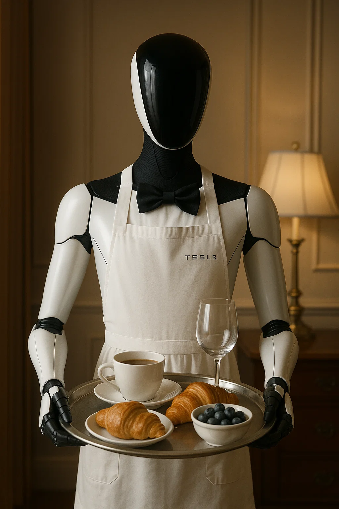
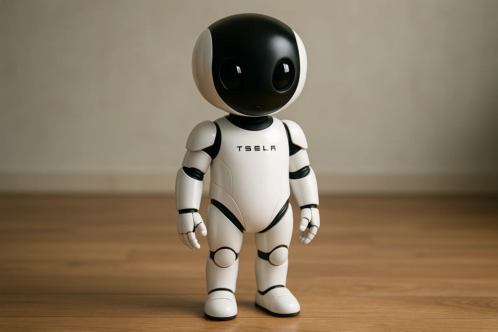

# Ethical Analysis and Metaphor Hacking: Tesla Optimus

Technology ethics case study examining privacy, labor displacement, and cultural framing of Tesla's Optimus humanoid robot, with proposed ethical design modules.

## Problem

General-purpose humanoid robots like Optimus combine always-on sensing, anthropomorphic design, and broad task automation, raising privacy, intimacy, and job-displacement concerns that standard device metaphors underplay.

## Approach

Combined a formal ethics analysis (privacy/intimacy, economic displacement) with "metaphor hacking", comparing servant/helper vs. child/learner framings of human–robot interaction. Proposed two design modules: Consent and Context Module (CCM) for visible recording control, and Human Impact Forecast Module (HIFM) for local employment impact reporting before deployment.

## Results

- Identified privacy risks from persistent audio/video capture in domestic and workplace settings
- Argued servant metaphors can mask labor substitution; learner metaphor better matches adaptive AI and shared responsibility
- Proposed CCM and HIFM as embeddable ethical guardrails without blocking innovation outright

## Tech stack

Academic case study (Markdown); illustrative images generated with OpenAI Sora

## How to run

Read `README.md` in any Markdown viewer or on GitHub. No build step required.

References cited: Kate Darling, Ryan Calo, Tesla AI Day 2022, and metaphor-hacking literature.

## Screenshot / demo

*Figure 1: Humanoid robot as a servant. Image generated using OpenAI Sora.*

*Figure 2: Humanoid robot as a child. Image generated using OpenAI Sora.*

**Author:** Daniel Demoz, Ethics for Design, AI, and Robotics
